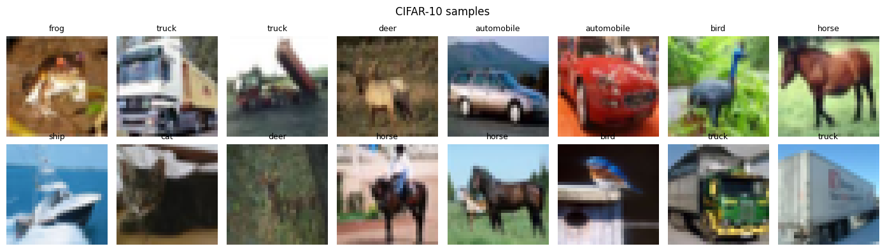
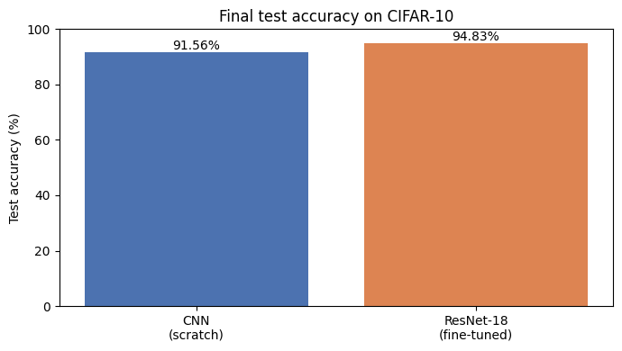
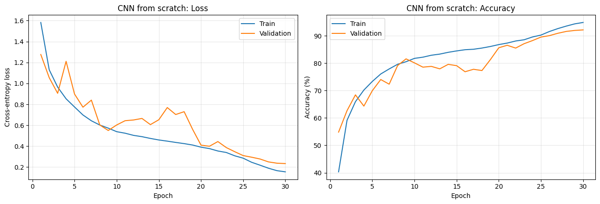

# CIFAR-10: CNN from Scratch vs. ResNet-18 Transfer Learning

**Is it better to train a small image classifier from scratch, or fine-tune a model pre-trained on ImageNet?**

This project trains both on [CIFAR-10](https://www.cs.toronto.edu/~kriz/cifar.html) (60,000 32×32 colour images, 10 classes) and compares accuracy, model size and training cost.



## Key results

| Model | Test accuracy | Parameters | Epochs | Training time |
|---|---|---|---|---|
| **ResNet-18 (fine-tuned)** | **94.83%** | 11.18M | 5 (2 + 3) | 4.4 min |
| CNN from scratch | 91.56% | 1.21M | 30 | 8.3 min |
| ResNet-18 (feature extraction only) | 85.25% | 11.18M (5,130 trained) | 2 | 0.8 min |

- **Transfer learning wins on accuracy** — fine-tuned ResNet-18 beat the scratch CNN by 3.27 points in only 5 epochs.
- **Fine-tuning matters** — frozen ImageNet features alone reached just 85.25%; unfreezing all layers added 9.6 points.
- **The small CNN is a strong lightweight option** — 91.56% with 9× fewer parameters, running on native 32×32 images, which makes it better suited to phones or embedded devices.



## Training curves — CNN from scratch



Validation accuracy fluctuated while the OneCycle learning rate was near its peak (epochs 10–18), then climbed steadily to 92.1% as the rate decreased. The final train–validation gap was only 2.7 points, so overfitting stayed low. The hardest classes were cats (80.6%) and dogs (86.6%).

## Methods

**Data**
- 45,000 train / 5,000 validation / 10,000 test split, fixed with a seed
- Augmentation: random crops (padding 4) and horizontal flips
- Best epoch chosen on validation accuracy; test set used once

**CNN from scratch (PyTorch)**
- Three convolutional blocks (64 → 128 → 256 channels), each with two conv layers, batch normalisation, max pooling and dropout
- Global average pooling + small fully connected classifier
- SGD with Nesterov momentum, weight decay and a OneCycle learning-rate schedule (peak 0.1), 30 epochs

**ResNet-18 transfer learning**
- ImageNet pre-trained weights; final layer replaced with 512 → 10
- Inputs upsampled from 32×32 to 224×224
- Stage 1 (feature extraction): train only the new layer for 2 epochs with Adam
- Stage 2 (fine-tuning): train all layers for 3 epochs with AdamW (lr 1e-4) and cosine annealing
- Mixed-precision training on a Google Colab T4 GPU

## How to run

```bash
pip install -r requirements.txt
```

Open `cifar10_cnn_vs_resnet18.ipynb` in Jupyter or [Google Colab](https://colab.research.google.com) (a GPU runtime is recommended). CIFAR-10 downloads automatically.

## Tools
Python · PyTorch · torchvision · NumPy · pandas · Matplotlib

---
*Completed as part of MGSC 673 (Deep Learning), Master of Management in Analytics, McGill University.*
